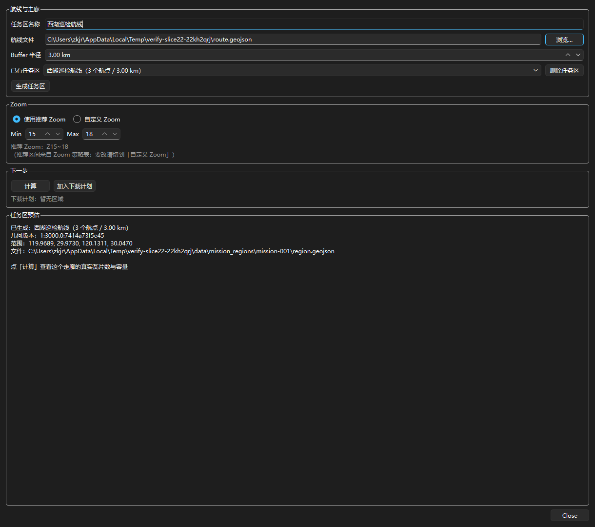
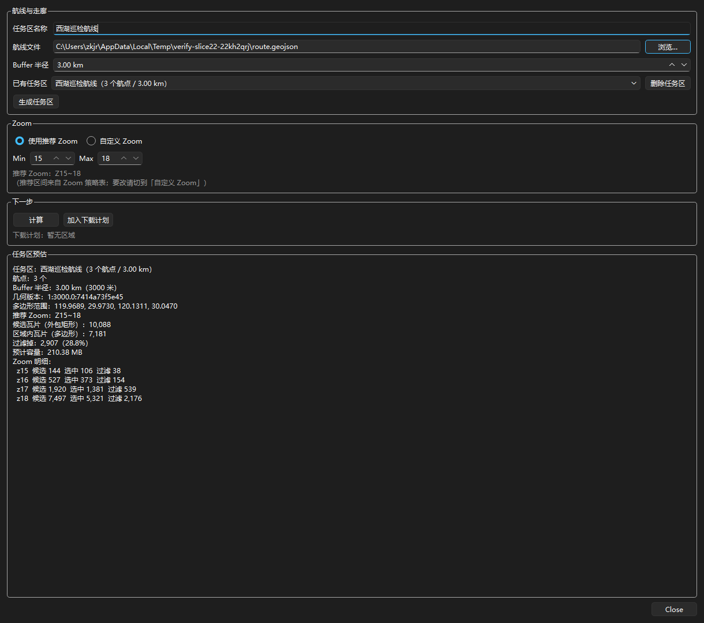
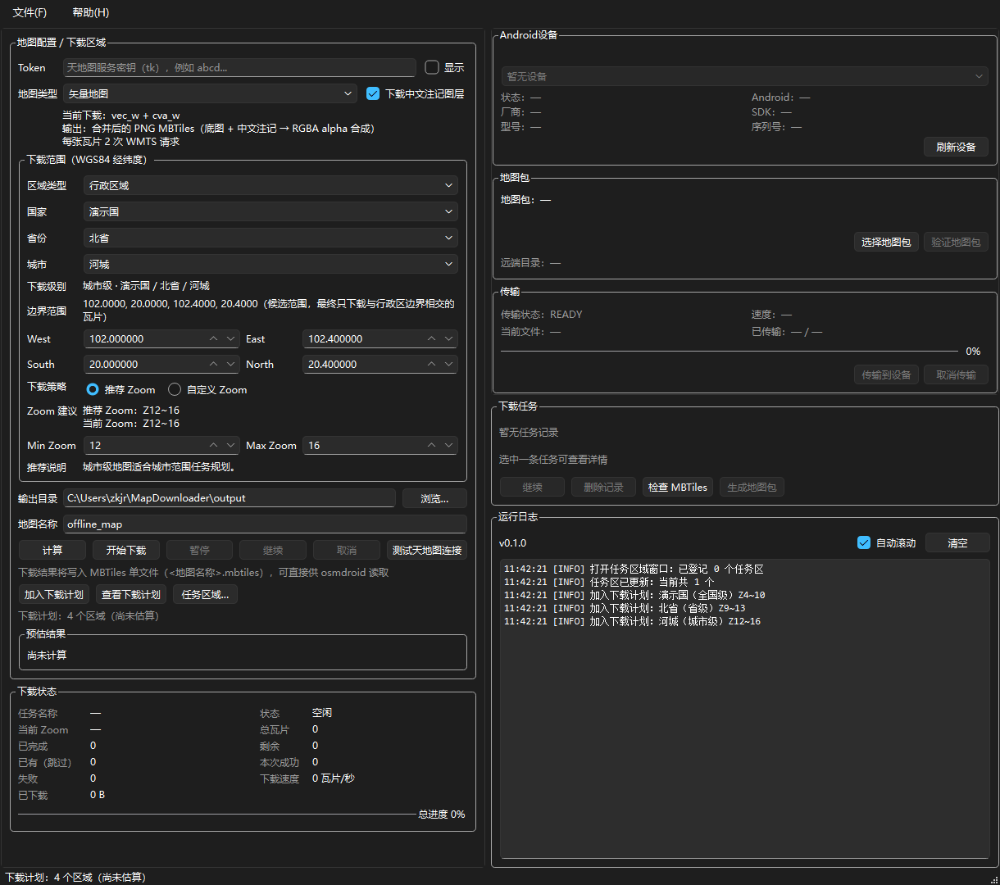
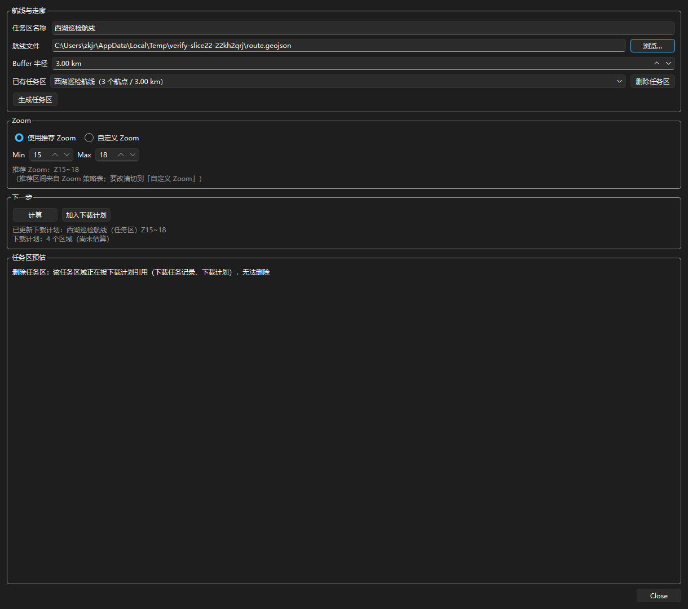

# 任务区域：航线走廊的高精度离线图（Slice 22）

> 一条作业航线两侧几百米到几公里 → 只在这条走廊里下 Z15~18。
> 同样一条航线，按"整座城市"下是几千万张瓦片，按走廊下是几万张。

## 这一版解决什么问题

高精度离线图的代价是**平方级**增长：Z15 到 Z18 每升一级，瓦片数翻四倍。
于是"给长三角下 Z15~18"意味着三千万张瓦片、上百 GB —— 绝大多数作业场景
根本装不下，也下不完。

而作业人员真正需要的往往只是**一条航线两侧的带状区域**：巡检、测绘、应急
巡查，都是"沿路看到的地方"。Slice 22 把这句需求变成一块可下载的地：

```text
航点（WGS84 经纬度）
   │  route_loader：只认 GeoJSON LineString / Feature / FeatureCollection
   ▼
LineString
   │  ★ region_builder：以航线中心为原点的**本地投影**（AEQD，单位=米）
   ▼
米制平面上的线
   │  buffer(半径_m)  ← 例如 5000，就是地面上 5 公里
   ▼
米制平面上的面
   │  投回 WGS84
   ▼
Mission 多边形            RegionType.POLYGON + RegionLevel.MISSION
   │                      落盘 data/mission_regions/<id>/{route,region}.geojson + metadata.json
   ▼
RegionTileEstimator       逐张判相交 → 候选矩形 / 走廊内 / 被过滤 三个数
   │                      推荐 Zoom Z15~18 来自 ZoomStrategyService
   ▼
DownloadRegion            region_type=polygon（与行政区**完全同构**）
   │                      geojson_path = region.geojson 的绝对路径
   ▼
DownloadPlan → PlanScheduler → DownloadManager
   排在市级之后            复用 Slice 20 / 21 的整条链路，**一行都没改**
```

## 最要紧的一条：按**米**缓冲，不按度

这是本 Slice 唯一真正容易做错、而且**错了也不报错**的地方：

```python
line.buffer(0.05)          # ✗ 0.05 度
```

"0.05 度"在广州是 5.5 公里，在漠河是 2.5 公里 —— 一个随纬度变化的缓冲半径
不是半径，是一个 bug。而且它**不会**抛异常：几何照样生成、瓦片照样算出来，
只是"我设的 5 公里"在北边变成了 2.5 公里，用户永远不知道。

正确做法是先把航线投到**以航线中心为原点的等距方位投影**（AEQD）上，在那个
平面上做缓冲（单位是米），再投回来：

```python
crs = f"+proj=aeqd +lat_0={center_lat} +lon_0={center_lon} +datum=WGS84 +units=m"
forward = Transformer.from_crs("EPSG:4326", crs, always_xy=True)
xs, ys = forward.transform(lons, lats)
buffered = LineString(zip(xs, ys)).buffer(5000, quad_segs=16, join_style="round")
polygon = shapely_transform(backward, buffered)
```

`tests/test_mission_region_builder.py` 用**地面宽度**守这一条（不是看代码里有没有
`buffer(0.05)`，那是字符串匹配，抓到的是写法不是行为）：同一条航线、同一个 5000 米
半径，在北纬 20° 与北纬 60° 缓冲出来的走廊地面宽度必须一样；而"按度缓冲 0.05"
在同样两个纬度上分别得到约 10.5 km 与 5.6 km —— 差近一倍。

> 关于圆头的一点细节：`quad_segs=16` 意味着圆头按每象限 16 段拟合，于是边界的弦
> 落在半径**内侧**，最短距离比半径少约 0.12%（3 km 时 3.6 米）。这个方向是安全的
> —— 多边形绝不会鼓到半径之外，不会多下用户没要的瓦片。

## 怎么用

1. 在「下载区域」那一排点 **「任务区域…」**（与「加入下载计划」「查看下载计划」并排）。
   它是**第三种**"要下哪块地"的来源：前两种是自定义矩形与行政区目录，都在下拉框里选；
   任务区的输入是一份航线文件加一个半径，所以有自己的窗口。
2. 填三样东西：
   - **任务区名称**（例如"西湖巡检航线"）；
   - **航线文件**：别的软件导出的 GeoJSON `LineString`（KML / GPX 会被明确拒绝，
     并告诉你该转成什么）；
   - **Buffer 半径**：界面按 **km** 填（默认 5），落盘按**米**存。
3. 点 **「生成任务区」** → 三个文件落盘，窗口里显示几何版本与范围。
4. 点 **「计算」** → 看到三个数：

   ```text
   任务区：西湖巡检航线（3 个航点 / 走廊 5.00 km）
   航点：3 个
   Buffer 半径：5.00 km（5000 米）
   几何版本：1:5000.0:9f2c1a3b4c5d
   多边形范围：119.9412, 29.9488, 120.1588, 30.0712
   推荐 Zoom：Z15~18
   候选瓦片（外包矩形）：1,204
   区域内瓦片（多边形）：742
   过滤掉：462（38.37%）
   预计容量：21.74 MB
   Zoom 明细：
     z15  候选 94   选中 61   过滤 33
     z16  候选 282  选中 178  过滤 104
     z17  候选 1068 选中 662  过滤 406
     ...
   ```

   **"候选 / 选中 / 过滤"三个数缺一不可**：只给一个"张数"用户看不出走廊到底
   省掉了多少 —— 而那正是本 Slice 存在的理由。
5. 点 **「加入下载计划」** → 与行政区进的是**同一份计划**，排在市级之后
   （全国 → 省 → 市 → 任务区 → 自定义）。
6. 后面的流程与 Slice 20 / 21 完全一样：在计划页估算 → 生成任务 →
   「开始执行」串行跑完。

## 几条刻意的设计

### 任务区是"多边形区域的又一个来源"，不是第二套下载系统

产物 `DownloadRegion` 与行政区**完全同构**：`region_type=polygon`、
`region_id=<mission-id>`、`geojson_path` 指向一份能读的 GeoJSON、过滤走同一个
`PolygonTileRegionFilter`。所以 Slice 16 的多边形链路（估算 / 下载 / 续传 /
Inspector / 打包）一行都不用改。

差别只有一处：行政区几何是**随程序分发的资源**（在 `resources/regions/` 下，靠
`region_id` 查目录），任务区几何是**用户数据**（在 `data/mission_regions/` 下，
只有一条路径）。为了让续传与 Inspector 能把一个 `region_id` 变回几何，`app.geo.region`
里加了一张**动态解析注册表**：

```python
register_region_resolver(callback)      # app.mission 在界面构造时注册
region_from_task(task)  → 先查静态目录，查不到就问注册表
region_from_metadata(…) → 同上
```

挂接做成**注册回调**而不是 import：否则 `app.geo` 会反过来依赖业务层，成环。
静态守卫（`scripts/verify_slice22_mission_region.py` 场景 I）盯着这条边。

### 几何只算一次，存下来给所有人用

航线 + 半径 → 多边形这一步**在创建时算一次**，落成 `region.geojson`。之后的估算、
下载、续传、Inspector 全部读**同一份文件**。为此：

- `MissionRegionStore.save()` 回填 `geojson_path`（几何的绝对路径），
  服务层把它塞进 `DownloadRegion.geojson_path`；
- 续传时 `region_from_task` → 解析回调 → 读同一个路径 → **逐张比对得到同一个
  瓦片集**；
- 绝不"用航线重新缓冲一遍"：那会得到一个"几乎一样"的几何，差几行几列不会让
  任何断言失败，但会让 Inspector 报出一堆假缺失。

### 改了航线或半径 = 新建一个任务区

`metadata.json` 里存 `geometryVersion = "<格式>:<半径米>:<航点摘要前12位>"`，
它同时被写进任务记录的 `boundary_version` 与 MBTiles metadata 的
`boundary_version`。同一份"航点 + 半径"永远得到同一个版本号。

于是"改一下半径"这件事只有一种做法：**另建一个**任务区。服务层直接拒绝
覆盖已存在的 id（消息里说明理由：悄悄改掉一个正在下载 / 已下载任务区的几何，
会让那批瓦片再也说不清是按哪一版几何裁的）。

`MissionRegionStore.load()` 还会把 `metadata.json` 记的范围与
`region.geojson` 的**实际范围**对一遍，对不上就报错（"这份几何已经被改过，
不能再用它续传"）—— 拿着一个和记录不一致的几何去续传，会让"上次下到哪了"
彻底失去依据。

### 三个文件、原子写、路径受限

```text
data/mission_regions/<mission-id>/
├── route.geojson      原始航线（LineString，人可读，用来"重建"）
├── region.geojson     缓冲后的多边形（**下载依据**）
└── metadata.json      半径 / 航点数 / 几何版本 / 范围 / 创建时间
```

- 三个文件都**原子写**（`tmp` → `fsync` → `os.replace`）：中途断电只会留下一个
  tmp，而不会留下一个"读得动但缺一半"的 metadata —— 后者比不存在的文件更危险。
- id 受两道闸：前缀必须是 `mission-`、内容只含小写字母数字与 `._-`；拼出来的
  路径还要再确认"解析后仍在根目录内"。两道都过不去就报错，**绝不"清理一下再用"**
  （`mission-../evil` 被清理成 `mission-evil` 之后，用户以为在操作 A，程序操作的是 B）。
- 落盘前递归扫键名，**拒绝 Token 与瓦片坐标**：这份文件会跟着地图包分发出去。

### 被引用时不许删

`MissionRegionService.delete()` 会先扫三份文件（`tasks.json` / `plans.json` /
计划执行记录）里有没有这个 id：

- 有引用 → 抛 `MissionRegionReferenced`，界面弹一条"该任务区域正在被下载计划引用
  （下载计划），无法删除"的**说明**，并且**不弹确认框** —— 让用户先点一次「是」
  再被拒绝，是把"删不掉"这条信息藏在一层点击之后，而那个「是」的含义是"我确定要删"。
- 没有引用 → 弹确认框，答「是」才真删（整个目录，`shutil.rmtree`）。
- 引用文件读不出来 → **报错而不是当作"没有引用"**：宁可挡一下，也不要留下一个
  打不开的任务记录。

### Inspector 找得到几何就算，找不到就认错

任务区包的 MBTiles metadata 里记着：

```text
region_type     = polygon
region_id       = mission-001
region_level    = mission          ← 任务区**反查不出**等级（几何不在资源目录里），必须落盘
buffer_meters   = 5000
boundary_version= 1:5000.0:9f2c1a3b4c5d
```

- 本机有这个任务区 → 拿 `region.geojson` 逐张判相交，算出**准确**的期望 / 缺失张数；
- 本机没有（包是在另一台机器上生成的，很常见）→ 覆盖度标 **UNKNOWN** 并说明原因，
  **绝不退回外包矩形**去算。按矩形算一个完整的走廊包会得出"缺了几十张"的结论，
  而那个包很可能是完整的 —— 用户会照着这个数字去重下，花掉配额与时间，
  最后发现还是"缺"。误报比"不知道"糟得多。

行政区包**不写** `region_level` / `buffer_meters`（等级能从 `region_id` 反查出来，
多写一个键是噪声）；manifest 里的 `region.type` 也仍然是 `polygon` 而不是
`mission` —— 那个键在 Slice 16 就定成"矩形还是多边形"，读它的地方（含 Android）
对认不出的取值一律按矩形兜底。两者各管一件事：`type` 是几何类型，`level` 是区域来源。

### Zoom 数字只来自策略表

任务区层里**没有任何 15 / 18**（`app/mission/**.py` 与任务区窗口的 AST 里都查过
整数字面量）。推荐区间一律走：

```python
strategy.recommend(MISSION_REGION_LEVEL)     # → Z15~18（DEFAULT_ZOOM_POLICIES）
```

`RegionLevel.MISSION` 这个字面量也只允许出现在 `app/mission/models.py` 一处
（收在 `MISSION_REGION_LEVEL` 常量里），其余地方引用它 —— 否则"任务区属于哪一级"
就会散落成多份，改一处漏一处。窗口里那两条纪律与「下载区域」那一栏一致：
推荐模式自动填（且两个框**只读**）、自定义模式**只提示绝不改写用户输入**。

> MISSION 策略的 `warning_max_zoom` 等于推荐上界（18，也就是 Tile Math 的上限），
> 所以"超出推荐"在任务区上按构造不可能发生，能提示的只有"推荐是哪个区间、你填的
> 是哪个区间"。这是刻意的：写一条永远不可能为真的警告，等于给后面的人留一个假坑。

## 这一版**不做**的事

- **不做地图编辑器**：不画航线、不拖控制点。本工具是"离线图打包器"，不是 GIS
  编辑器 —— 航线在别的软件里画好、导出 GeoJSON，这里只负责"按米缓冲、算清代价、
  进计划"。自己画一个半吊子编辑器只会让用户既画不准也导不出。
- **不吃 KML / GPX**：只认 GeoJSON LineString。转换很容易做，但"一份文件里到底
  哪条线是航线"这件事在 KML 里有太多种表达，猜错的代价是一条跑偏的走廊。
  拒绝时会明确说"请先转成 GeoJSON"。
- **不支持跨 180° 经线 / 极端航线**：跨度超过 10 度或跨日期变更线直接拒绝，
  理由与纬度上限一样 —— 与其在下单阶段给出一个荒唐的张数，不如在导入这一步说清楚。
- **不做多航线 / 多段任务**：一个任务区一条航线。要下两条就建两个。（当前版本
  也刻意拒绝 `MultiLineString` 与含多条线的 `FeatureCollection`：默默挑一条，
  用户永远不知道自己少下了一半。）
- **不动下载器**：`MapDownloadService` / `DownloadWorker` / MBTiles 格式 /
  `PlanScheduler` 一行未改。任务区只是给计划多喂了一个 `region_id`。

## 代码位置

| 文件 | 职责 |
| --- | --- |
| `app/mission/models.py` | `MissionWaypoint` / `MissionRegion` / 元数据 / id 校验 / `MISSION_REGION_LEVEL` |
| `app/mission/route_loader.py` | GeoJSON → 航点（只认线；KML/GPX 给可操作的拒绝消息） |
| `app/mission/region_builder.py` | **米制缓冲**（AEQD 投影 → buffer → 投回）+ 几何版本 + GeoJSON 文档 |
| `app/mission/mission_region_store.py` | 三文件原子写 / 读 / 删 / 路径受限 / 禁用键名 |
| `app/mission/mission_region_service.py` | 业务入口 + `CompositeRegionService` + 解析注册表挂接 |
| `app/ui/mission_region_dialog.py` | 任务区域窗口（生成 / 计算 / 加入计划 / 删除） |
| `app/ui/download_panel.py` | 面板上的「任务区域…」入口 |
| `app/geo/region.py` | `DownloadRegion` 的任务区字段 + 动态解析注册表 |
| `app/planning/download_plan.py` | `PLAN_LEVEL_ORDER` 里 MISSION 排在 CITY 之后 |
| `app/mbtiles/models.py` | MBTiles metadata 多写 `region_level` / `buffer_meters` |

依赖方向：`app.mission` → `app.geo` / `app.planning` / `app.regions`，**单向**。
`app.mission` 不 import `app.services` / `app.workers` / `app.ui`（它只产出一块地）。

## 验收

```bash
# 单元测试（航线导入 / 米制 Buffer / 持久化 / 计划接线 / 窗口按钮）
.venv/Scripts/python.exe -m pytest tests/test_mission_route_loader.py \
    tests/test_mission_region_builder.py tests/test_mission_region_store.py \
    tests/test_mission_plan_integration.py tests/test_mission_region_dialog.py -q

# 实机验收（真窗口 / 真按钮 / 真包 / 截图落 docs/）
.venv/Scripts/python.exe scripts/verify_slice22_mission_region.py
```

实机验收覆盖 13 条手工清单：入口按钮 → 生成（三个文件落盘 + 米制证据）→
计算（三个数字 + 与生产同源比对）→ 加入计划（顺序）→ 续传（同一份几何）→
Inspector（完整 / 缺一张 / 几何不在本机）→ 删除保护（被引用时拒绝）→
重启（任务区还在 / 坏目录不阻塞启动）。








